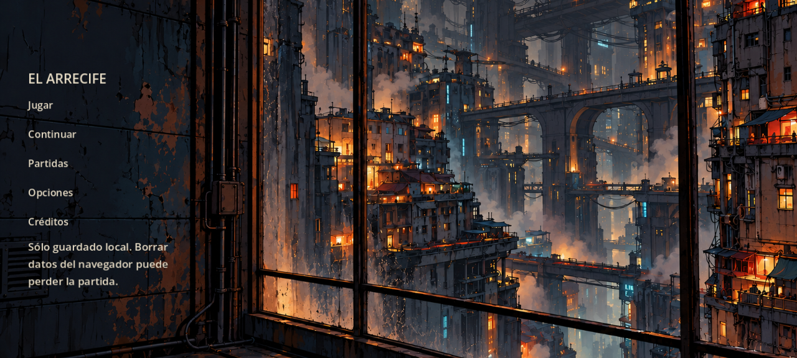
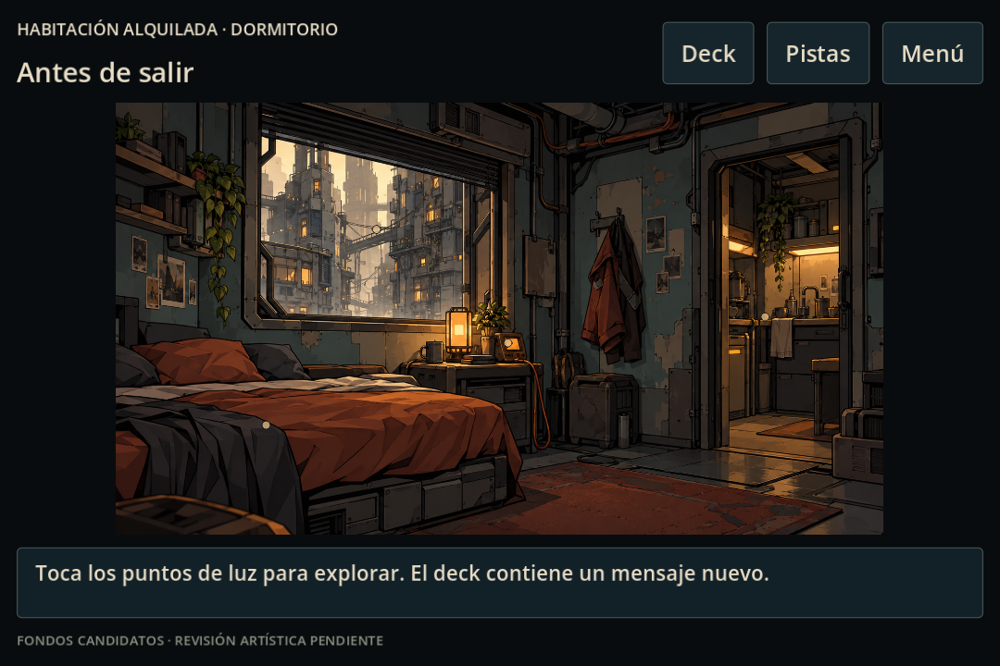
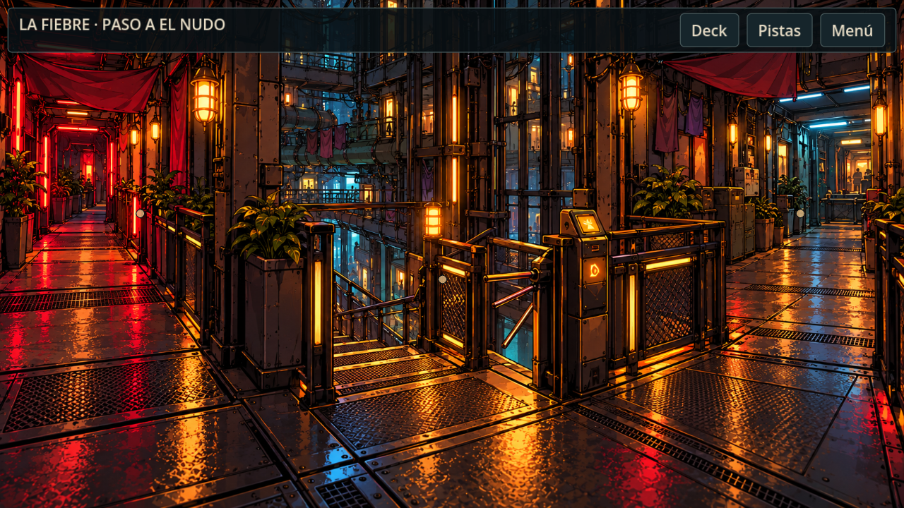
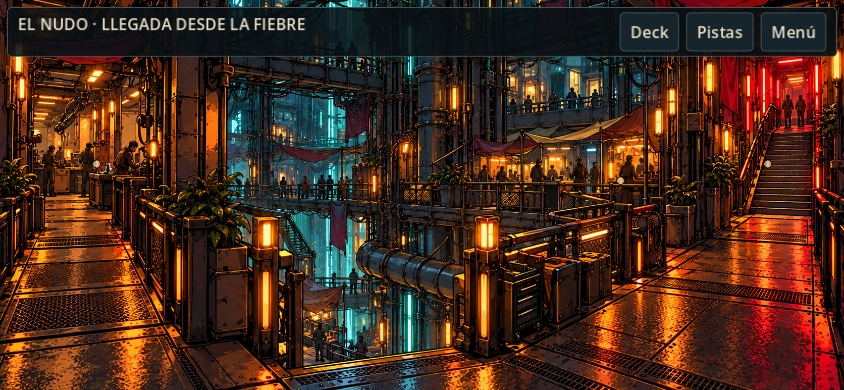
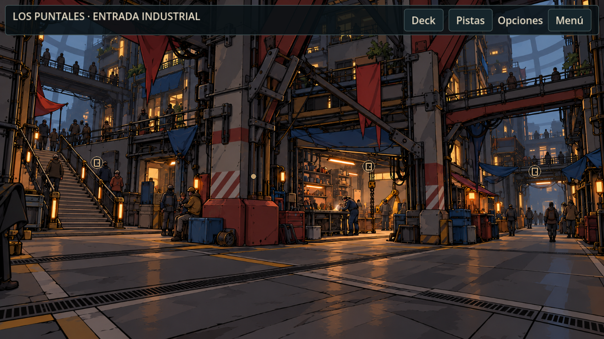
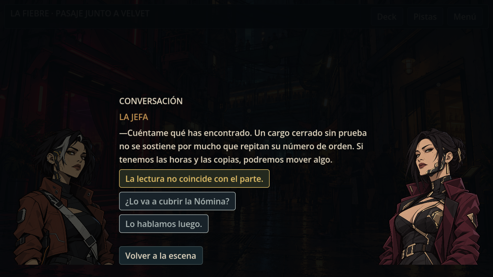
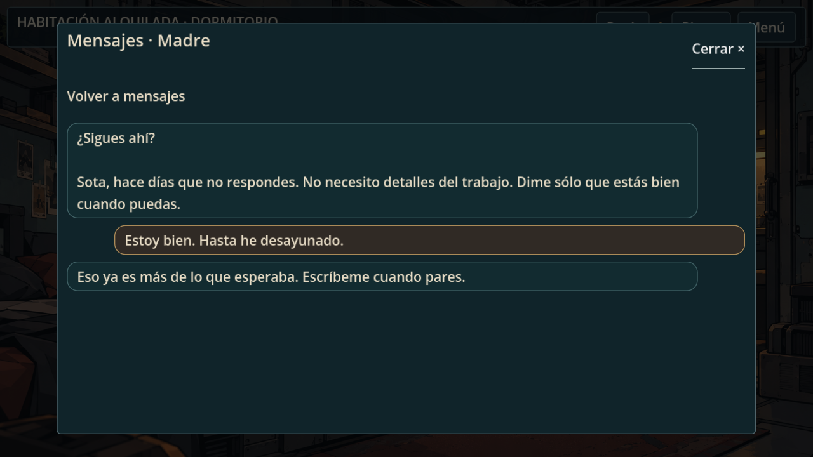

# EL ARRECIFE

Aventura narrativa **2D ilustrada, en primera persona**, en el universo de *CARGA ADMISIBLE*. Exploras a través de los ojos de Sota: clic o toque sobre objetos, personas y accesos. Godot **4.7.2**, GDScript y español de España.

## Estado: versión 0.2.0 para primera prueba

Tres pantallas de apertura (logo, autoría y orientación), menú, introducción saltable, tres habitaciones y seis vistas de cada cota: La Fiebre, El Nudo y Los Puntales. Hay exploración por clic/toque, diálogo con retratos originales, deck, mensajes, tres contratos completos, documentos, terminal, ambiente sonoro y guardado local.

El pasaje de La Fiebre incorpora un primer ambiente visual animado: luz de Velvet y reflejos, vapor de la ventilación y bruma lejana. Desde la exploración, **Opciones → Reducir movimiento** detiene estos efectos. [Ver el piloto animado a 844×390](docs/evidence/ambient_fiebre_visible_844x390.gif). El menú y las demás vistas aún no tienen capas animadas.

El arco narrativo y sus dos decisiones de cierre están implementados. El deck reúne conversaciones con la madre, la hermana, Lía, la Jefa y el enlace policial; llegan según el progreso, permiten respuestas breves y conservan lo leído. La duración objetivo de unos 30 minutos aún no se ha medido en una partida del autor. Los 21 fondos de exploración y el fondo de menú son candidatos ilustrados; la ficción nueva y el arte requieren su revisión antes de publicar la versión final. [Guía para la primera partida](docs/GUIA_PRIMERA_PARTIDA.md).

## Rumbo actual

El único juego activo es [`game/project.godot`](game/project.godot): aventura **2D de vistas ilustradas fijas en primera persona**. Sota es la protagonista, pero el jugador ve el mundo a través de sus ojos y explora con clic o toque. La antigua demo de movimiento lateral en 3D pertenece a la etapa archivada y no forma parte de esta versión.

El alcance acordado por ahora es el apartamento y tres cotas, con **21 vistas en total y tres misiones**. La 0.2.0 reúne ese recorrido para la primera prueba con un jugador. El siguiente paso es observar una partida completa, medir su duración y corregir claridad, ritmo, controles, mensajes y continuidad visual. Después vendrán la revisión artística y narrativa del autor, las pruebas en dispositivos reales y la preparación de una publicación final. [Estado y pendientes](proceso/ESTADO_DEL_PROYECTO.md).

## Imágenes del juego

Capturas del juego ejecutándose; los fondos y la presentación aún pueden cambiar tras la revisión artística.



| Apartamento de Sota | La Fiebre |
| --- | --- |
|  |  |
| El Nudo | Los Puntales |
|  |  |
| Conversación | Mensajes del deck |
|  |  |

[Más capturas y resultados de las pruebas](docs/VALIDACION.md).

## Abrir y jugar

1. Abre Godot 4.7.2 e importa **`game/project.godot`**.
2. Pulsa **F5**. Después de las tres pantallas de apertura, selecciona **Jugar**. Puedes adelantarlas con clic, toque o Intro antes de que termine su breve espera. También puedes ejecutar:

```sh
godot --path game
```

En este Mac:

```sh
/Applications/Godot.app/Contents/MacOS/Godot --path game
```

Todo se juega con clic o toque. **En móvil se juega sólo en horizontal**: el aviso de giro aparece antes del menú y vuelve a cubrir la partida si se gira el dispositivo a vertical. En ordenador se puede usar cualquier orientación de ventana. El menú muestra la ciudad desde una ventana, sin retrato de Sota; sus opciones son enlaces de texto. **Deck** abre mensajes, contratos, archivo, noticias, contactos y lugares; tras el tercer contrato conserva el cierre. Toca los pequeños puntos de luz sobre los objetos y accesos; cada uno tiene un área pulsable acotada alrededor. **Pistas** abre la lista de acciones y permite ocultarlos. Los textos extensos se desplazan. En diálogo, el amarillo avanza el contrato y el gris ofrece información opcional. Opciones permite ajustar por separado ambiente y sonidos de acción.

El logo original de **EL ARRECIFE PRODUCTS**, suministrado por el autor, abre el juego. En Web, la secuencia de apertura se muestra una vez por pestaña: **recargar lleva directamente al menú** y abrir el juego en una pestaña nueva vuelve a mostrarla. El aviso de orientación sigue activo incluso cuando se omite la apertura.

**Menú → Partidas** permite exportar un archivo JSON de la partida guardada e importar una copia. La importación comprueba el archivo y pide confirmación antes de sustituir el progreso activo; **Copias anteriores** permite recuperar los respaldos locales creados al reiniciar o importar. En Web, revisa que el navegador haya descargado el archivo antes de borrar datos del sitio: borrar esos datos elimina también las copias locales anteriores. El JSON contiene decisiones de la historia; guárdalo en privado. [Panel de partidas](docs/evidence/partidas_1280x720.png).

Mientras la exportación Web descarga el motor aparece un fondo neutro; el logo sólo se muestra dentro de la secuencia de apertura.

### Recorrido de comprobación

Deck → hilo de la Jefa → aceptar el parte del agua → copiar la lectura doméstica → hablar con la Jefa → comprobar la ficha en El Nudo y la conducción en Los Puntales → entregar el parte. Tras cada entrega aparece el siguiente mensaje: la orden duplicada se cierra con un informe en el puesto de red; la prueba de presión vuelve a la Jefa y termina con una decisión sobre las copias. Los demás hilos son personales y pueden responderse cuando lleguen. **Menú → Continuar** recupera el progreso.

### Web local

Instala las plantillas de exportación de **la misma versión** del motor:

```sh
godot --headless --path game --export-release Web
python3 tools/serve_web.py 8767
```

Abre `http://127.0.0.1:8767`. Este servidor local evita reutilizar el paquete anterior desde la caché del navegador al reexportar; recarga la pestaña para cargar la versión nueva. El directorio `build/` es regenerable y está excluido de Git. No abras el HTML con `file://`. La exportación Web usa Compatibility, sin hilos ni extensiones.

El guardado usa `user://partida.json`, `.tmp` y `.bak`; una partida nueva conserva además una copia `.previa-*`. El menú avisa de que el progreso del invitado está sólo en el dispositivo. En navegador, borrar los datos del sitio, cambiar de origen o usar modo privado puede hacer perder el acceso; el archivo exportado permite restaurarlo manualmente. **No hay guardado en la nube ni cuentas activas.** La base de migración y la sincronización simulada se explican en [Protección del progreso](docs/SAVE_SYSTEM_ARCHITECTURE.md).

### Ensayo de Web en una subruta

Con una **carpeta de ensayo vacía** (usa un nombre nuevo para cada exportación), sin escoger el slug público:

```sh
mkdir -p game/build/staging/ensayo
godot --headless --path game --editor --import --quit
godot --headless --path game --export-release Web build/staging/ensayo/index.html
python3 -m http.server 8767 --bind 127.0.0.1 --directory game/build/staging
```

Abre `http://127.0.0.1:8767/ensayo/`. La carpeta generada contiene los archivos estáticos que se subirían por FTP al subdirectorio aprobado, **sin llevar `build/` ni `tests/` dentro del PCK**. Esta prueba local no equivale a HTTPS, persistencia ni autenticación en `universo.israelzamora.es`. La ruta `/titulodeljuego/` de la planificación sigue siendo un marcador; el slug final requiere decisión del autor y ensayo en el hosting.

### Paquete para la primera prueba privada

Desde un checkout con Godot 4.7.2 y sus plantillas Web:

```sh
python3 tools/build_playtest.py
```

Si Godot no está en `PATH`, define `GODOT_BIN` con la ruta del ejecutable. El script importa, exporta en una carpeta nueva, comprueba los archivos y crea `game/build/el-arrecife-0.2.0-<commit>-web.zip` y su `.sha256`. Si hay cambios sin confirmar, el nombre lleva `-dirty`: no lo confundas con la entrega del commit. El ZIP contiene `MANIFEST.json` con versión, Godot, commit y hashes de cada archivo, además de [instrucciones sin soluciones](docs/LEEME_PRUEBA.md). No incluye la [guía detallada](docs/GUIA_PRIMERA_PARTIDA.md), que se entrega sólo después de la sesión observada.

Comprueba un paquete concreto con `python3 game/tests/playtest_package.py game/build/<nombre>.zip`. Al extraerlo, sirve la carpeta por HTTP(S); la hoja incluida explica cómo hacerlo en local. `build/` se regenera y no se versiona. El paquete privado no autoriza despliegue en el dominio oficial.

## Comprobar

```sh
godot --headless --path game --editor --import --quit
godot --headless --path game --script tests/run.gd
godot --path game --script tests/run.gd
godot --headless --path game --script tests/save_integrity.gd
godot --headless --path game --script tests/save_file_ui.gd
godot --headless --path game --script tests/save_sync.gd
python3 game/tests/preservation.py
```

La prueba con GPU guarda capturas reales en `docs/evidence/`; usa partidas temporales aisladas. [Resultados y límites](docs/VALIDACION.md).

## Organización

- `game/`: único juego activo. Datos narrativos en JSON; controles nativos reutilizables.
- `art/originals/`: originales protegidos, incluidos los dos retratos y las figuras históricas del acceso.
- `art/prompts/`: especificaciones y registro de iteraciones de los fondos candidatos.
- `docs/`: diseño, dirección artística, validación, preservación y atribución.
- `canon_el_arrecife.md`: canon literario, sólo consulta.
- `proceso/ESTADO_DEL_PROYECTO.md`: continuidad vigente.

[Diseño](docs/GAME_DESIGN.md) · [Arte](docs/ART_DIRECTION.md) · [Tareas](task.md) · [Recuperación de las etapas anteriores](docs/RECUPERACION.md).

La producción 2D está en **`main`**, la rama predeterminada. La etapa anterior sigue recuperable desde el checkpoint `433e099` y la rama local `backup/pre-reboot-20261020`; sus prototipos 3D no forman parte del juego activo.
