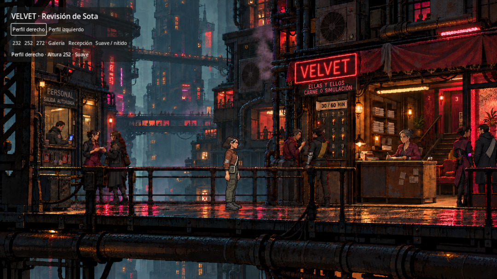

# EL ARRECIFE · Videojuego

Juego de investigación en desarrollo, ambientado en la megaciudad vertical de EL ARRECIFE. El título definitivo está pendiente. El autor y el asistente desarrollan y prueban el proyecto.

La producción definitiva utiliza **Godot 4.7.2, GDScript y 2D Compatibility**, con exportación Web. El caso completo todavía se encuentra en el prototipo JavaScript; la versión Godot permite revisar a Sota, de perfil, dentro de Velvet. La migración y las animaciones siguen en curso.



## Abrir el proyecto

Clonar el repositorio e importar `godot/project.godot` desde Godot 4.7.2. Ejecutar con F5. La escena actual compara ambos perfiles de Sota, alturas, ubicación y filtrado; todavía no contiene desplazamiento ni diálogos.

Instalación, plantillas y exportación: [godot/README.md](godot/README.md).

Para ejecutar el prototipo narrativo, con Python 3 y Node.js disponibles:

```sh
cd juego
npm start
```

Abrir `http://127.0.0.1:8765/`. No necesita instalar dependencias de npm.

## Comprobar el proyecto

```sh
cd juego
npm test
```

Para Godot, desde la raíz, usando el ejecutable de Godot disponible en el equipo:

```sh
godot --headless --path godot --editor --import
godot --headless --path godot --script tests/verificacion.gd
godot --headless --path godot --script tests/escala.gd
```

En macOS, si `godot` no está en PATH, usar `/Applications/Godot.app/Contents/MacOS/Godot`.

## Organización y continuidad

| Carpeta o documento | Contenido |
| --- | --- |
| `godot/` | Proyecto de producción, recursos y comprobaciones. |
| `juego/` | Prototipo JavaScript del caso completo y sus pruebas. |
| `trabajo/` | Dirección, recursos anteriores, prompts y diseño. |
| `proceso/` | Estado real, decisiones, historial y respaldo. |
| [task.md](task.md) | Tareas y criterios de cierre; una tarea cada vez. |
| [AGENTS.md](AGENTS.md) | Instrucciones para continuar trabajando. |

Antes de retomar, leer [ESTADO_DEL_PROYECTO.md](proceso/ESTADO_DEL_PROYECTO.md). La documentación interna contiene soluciones del misterio. Los recursos y prompts anteriores se conservan por versiones.

Las cachés de Godot, exportaciones generadas, metadatos de Finder y credenciales de exportación se excluyen de Git. Se conservan los archivos `.import` y `.uid` necesarios para reproducir el proyecto. El editor y las plantillas se instalan aparte; no forman parte del repositorio.

Este repositorio contiene el proyecto de desarrollo. Todavía no hay una publicación del juego para jugadores.
