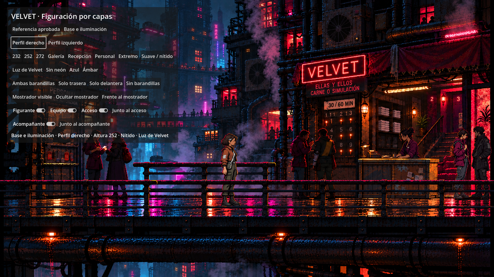

# EL ARRECIFE · Videojuego

Juego de investigación en desarrollo, ambientado en la megaciudad vertical de EL ARRECIFE. El título definitivo está pendiente. El autor y el asistente desarrollan y prueban el proyecto.

La producción definitiva utiliza **Godot 4.7.2, GDScript y 2D Compatibility**, con exportación Web. El caso completo todavía se encuentra en el prototipo JavaScript; la versión Godot permite revisar a Sota, de perfil, dentro de Velvet. La migración y las animaciones siguen en curso.

**Dirección artística · 10 de octubre:** vamos a renovar sprites, modelos, personajes, objetos, animaciones y entornos por capas para que sean más pixel art, más cercanos al estilo de REPLACED. Se conserva la identidad de Sota y su presentación solo de perfil. [Criterios vigentes](trabajo/direccion_artistica.md); renovación pendiente en [task.md](task.md). Pase corregido de Sota, con píxel más intenso y rostro con ojos apenas insinuados y sin rasgos detallados, integrado con el Velvet aportado por el autor; [comparación del retoque](trabajo/arte/revisiones/escala_v5/README.md). El autor aprueba el estilo vigente. La escena compara ese atlas con una [base sin neón e iluminación separada](trabajo/arte/revisiones/luz_v2/README.md), con color, intensidad y dirección controlables. Esta variante nueva está pendiente de valoración.

**Suelo y capas · 12 de octubre:** el recorrido lateral sigue horizontal y la pasarela conserva profundidad. Tras la corrección del autor, Sota se apoya en el centro (y = 705), entre barandilla trasera (base y = 675) y delantera (base y = 735), con orden de dibujo fijo. La delantera recorre todo el ancho; la trasera conserva el tramo sobre el hueco central. [Barandillas y comprobaciones Godot/Web](trabajo/arte/revisiones/recorrido_v1/README.md); [fondo y prompts conservados](trabajo/arte/entornos/velvet/suelo_v1/README.md). T07 continúa en curso; geometría de T07.3 valorada positivamente por el autor, que destaca la perspectiva como esencial. Barandillas de T07.4 aprobadas visualmente, incluida trasera junto a la gente. [Mostrador independiente T07.5](trabajo/arte/revisiones/mostrador_v1/README.md) conservado; [figurante y equipo independientes T07.6](trabajo/arte/revisiones/recepcion_v1/README.md) conservados. [Persona con mochila junto a la escalera T07.7](trabajo/arte/revisiones/acceso_v1/README.md) conservada; [acompañante y entrada sin ambas personas T07.8](trabajo/arte/revisiones/acompanante_v1/README.md) integrados y comprobados en Godot/Web, pendientes de valoración del recurso nuevo. El autor aprueba separar personas para actividad/interacción y propone posibles diálogos. Resto de capas, conversaciones, movimiento e iluminación espacial pendientes.



## Abrir el proyecto

Clonar el repositorio e importar `godot/project.godot` desde Godot 4.7.2. Ejecutar con F5. La escena actual compara la referencia aprobada de Sota y la base con iluminación separada, ambos perfiles, alturas, ubicación, filtrado y color del contorno. Elegir **Galería / Recepción / Personal / Extremo** y alternar **Ambas barandillas / Solo trasera / Solo delantera / Sin barandillas** para comprobar los dos bordes y sus oclusiones. **Frente al mostrador** permite revisar el mueble independiente con **Mostrador visible / Ocultar mostrador**. Los interruptores **Figurante / Equipo / Acceso** controlan esos planos por separado. **Junto al acceso** coloca a Sota frente a la figura de la mochila; **Acompañante / Junto al acompañante** permiten revisar la segunda persona. Todavía no contiene desplazamiento ni diálogos.

Instalación, plantillas y exportación: [godot/README.md](godot/README.md).

Para ejecutar el prototipo narrativo, con Python 3 y Node.js disponibles:

```sh
cd juego
npm start
```

Abrir `http://127.0.0.1:8765/`. No necesita instalar dependencias de npm.

## Comprobar el proyecto

```sh
cd juego
npm test
```

Para Godot, desde la raíz, usando el ejecutable de Godot disponible en el equipo:

```sh
godot --headless --path godot --editor --import
godot --headless --path godot --script tests/verificacion.gd
godot --headless --path godot --script tests/escala.gd
```

En macOS, si `godot` no está en PATH, usar `/Applications/Godot.app/Contents/MacOS/Godot`.

## Organización y continuidad

| Carpeta o documento | Contenido |
| --- | --- |
| `godot/` | Proyecto de producción, recursos y comprobaciones. |
| `juego/` | Prototipo JavaScript del caso completo y sus pruebas. |
| `trabajo/` | Dirección, recursos anteriores, prompts y diseño. |
| `proceso/` | Estado real, decisiones, historial y respaldo. |
| [task.md](task.md) | Tareas y criterios de cierre; una tarea cada vez. |
| [AGENTS.md](AGENTS.md) | Instrucciones para continuar trabajando. |

Antes de retomar, leer [ESTADO_DEL_PROYECTO.md](proceso/ESTADO_DEL_PROYECTO.md). La documentación interna contiene soluciones del misterio. Los recursos y prompts anteriores se conservan por versiones.

Las cachés de Godot, exportaciones generadas, metadatos de Finder y credenciales de exportación se excluyen de Git. Se conservan los archivos `.import` y `.uid` necesarios para reproducir el proyecto. El editor y las plantillas se instalan aparte; no forman parte del repositorio.

Este repositorio contiene el proyecto de desarrollo. Todavía no hay una publicación del juego para jugadores.
