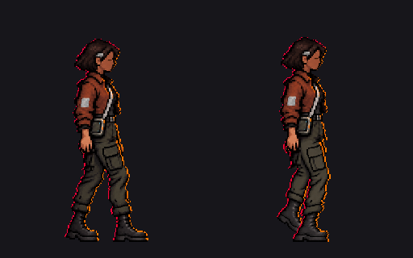

# Sota · apoyo derecho, una clave aislada

14 de octubre de 2026. **Prueba visual con visto bueno del autor para continuar; no integrada.** Se continúa desde el [contacto derecho v2 aprobado visualmente](../contacto_derecha_diagnostico_v1/README.md) con una sola clave nueva: apoyo derecho, fase `8/32 = 0,25`. Tras ver la comparación, el autor responde «bien, continuemos» el 15 de octubre. Este visto bueno permite preparar la [siguiente clave aislada](../impulso_derecho_v1/README.md); no aprueba todavía un ciclo ni su integración.

[Apoyo aislado, 256 × 320](apoyo_derecho_prueba_v1.png) · [ampliación 4× con `nearest`](apoyo_derecho_prueba_v1_4x.png).

## Preparación y límites

- Se pidieron dos referencias visuales con el editor de imágenes. [Intento 1](referencia_ia_intento1.png) abrió excesivamente la pierna lejana; [intento 2](referencia_ia_intento2.png) la aproximó. Se conservan los [prompts exactos, en inglés](prompts.txt). Ninguno de los dos PNG grandes es un sprite importable.
- [`preparar_apoyo.gd`](preparar_apoyo.gd) muestrea el intento 2 con `nearest` a 256 × 320, asigna su ropa inferior a colores de la clave de contacto y reemplaza la parte superior por los **píxeles exactos del contacto v2 desplazados 2 px hacia arriba**. Conserva la mano original y no copia el bolsillo antiguo del reposo.
- Las botas de la referencia quedaban demasiado separadas para la fase v4. Se acercan por debajo de la rodilla sin estrechar sus formas: la lejana avanza hasta 6 px y la cercana retrocede hasta 22 px. Es una corrección geométrica **provisional**; la rodilla, los pliegues y el cruce deben juzgarse visualmente. La pierna cercana mantiene el único bolsillo; la lejana es lisa.
- Pruebas: 256 × 320; alfa solo 0/255; 11.688 píxeles opacos; caja visible `(87,46)..(151,299)`; cero RGB ajenos al contacto v2; cero diferencias en la parte superior tras compensar los 2 px de oscilación. El script comprueba marco, alfa, región superior y píxeles de ambos apoyos mediante aserciones.
- Cinemática v4 de la fase 8: puntera lejana aproximada `(128,36;286,48)`, cercana `(151,86;293,33)` en una celda de 256 × 320; oscilación corporal `-2 px`. La imagen final tiene píxeles en `(128,286)` y `(150,293)`, pero la superposición impide certificar con el contorno visible que ambas punteras reproduzcan exactamente el modelo. No se ha medido deslizamiento porque solo hay dos claves separadas.

**Pendiente:** valorar la continuidad de pelvis, grosor de ambas piernas, bolsillo único, cruce, puños y botas junto a las siguientes claves. La pose deriva de una referencia generada y un ajuste de píxeles; todavía no es un redibujo manual completo. No cambiar el atlas activo por esta prueba.
