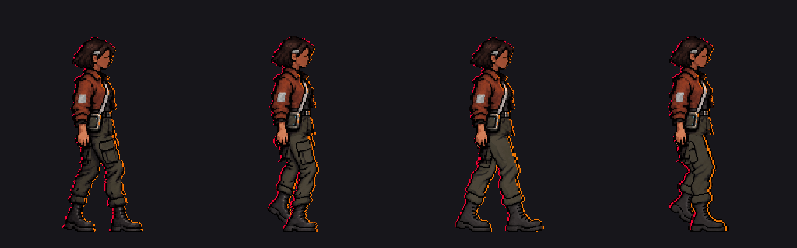

# Sota · avance derecho, diagnóstico de la cuarta clave

15 de octubre de 2026. El autor autorizó continuar tras ver la tercera pose. Se preparó **una única muestra aislada de fase 24/32 = 0,75**, pero **no supera la comprobación de apoyos v4** y no se presenta como sprite terminado ni se integra en el juego.

[Muestra de diagnóstico 256 × 320](avance_derecho_diagnostico_v1.png) · [ampliación 4× sin interpolación](avance_derecho_diagnostico_v1_4x.png) · [objetivos v4 marcados a 4×](guia_punteras_v4_4x.png). En la guía, **cian** marca la puntera de la pierna cercana elevada `(128,280)` y **amarillo** la puntera de la pierna lejana plantada `(152,298)`; las marcas no forman parte de la muestra.

Tras la aprobación del balanceo y las manos, [esta guía actualizada a 4×](guia_fase24_manos_aprobadas_4x.png) muestra **la misma base de piernas aún pendiente**, con la cuarta clave de brazos/manos aceptada arriba. Los marcadores conservan sus coordenadas y tampoco forman parte de un sprite jugable.

El autor señaló después un hueco bajo esa mano. Se conserva la guía anterior y se añade [la guía con el hueco corregido](guia_fase24_hueco_corregido_4x.png), basada en la [cuarta clave v2 aislada](../manos_sota_v1/README.md). La corrección afecta solo a 21 píxeles de esa unión; **los apoyos de las botas siguen pendientes**.

## Resultado

- Cuatro [referencias generadas y prompts exactos en inglés](prompts.txt) quedan conservados. La primera invirtió las piernas; las otras corrigieron bolsillo y compactaron la postura, pero no alcanzaron los apoyos v4. Ninguna referencia grande es un sprite utilizable.
- [`preparar_avance.gd`](preparar_avance.gd) muestrea la última con `nearest` en 256 × 320, asigna los colores a la paleta del contacto v2, copia exactamente las filas 0..173 del apoyo y recupera la mano aprobada. Alfa binaria, caja visible `(90,46)..(167,299)`, pivote común `(128,300)`. El bolsillo se sitúa en la pierna cercana elevada; la pierna lejana plantada no lleva bolsillo.
- El contorno derecho de la bota plantada llega a x≈167, mientras que la puntera v4 de fase 24 está en `(151,86;297,68)`: **unos 15 px demasiado adelante**. La puntera elevada debería estar en `(128,36;279,65)` y quedar 18 px por encima de la plantada; su contorno se solapa con la otra bota y no se puede certificar su posición exacta desde el PNG plano. La zona del bolsillo también cambia de forma respecto a las tres claves previas y podría leerse como dos paneles.
- La cabeza, equipo y torso se mantienen; esta muestra histórica todavía tiene la mano fija. La guía actualizada usa la prueba de manos que el autor ha valorado positivamente. Las comprobaciones técnicas de tamaño, alfa y paleta **no prueban** anatomía, ausencia de deslizamiento o continuidad animada.

## Guía de corrección manual

1. Trabajar en una copia de 256 × 320 de la [cuarta clave con manos](../manos_sota_v1/clave_3_manos_prueba_v1.png), con pivote `(128,300)`. Conservar pelo, rostro, chaqueta, correa, bolsa/deck y el gesto de brazos/manos aprobado; no recortar la lámina conceptual como fotograma.
2. Redibujar desde la cadera hasta ambas botas en la cuadrícula final. La pierna **lejana sin bolsillo** soporta el peso y termina en la puntera `(152,298)`; la **cercana con un único bolsillo** se eleva y termina en `(128,280)`. Ambos pies apuntan a la derecha. Acercar la bota plantada mediante redibujo de cadera, muslo, rodilla, caña y suela, no desplazando solo la bota.
3. Mantener grosor comparable al contacto y al impulso, pelvis continua y un hueco legible entre pantorrillas. Usar un bolsillo rectangular con una sola tapa en la pierna elevada; revisar que no aparezca un segundo panel al cruzarse las piernas.
4. Tomar colores solo de la referencia v7 rasterizada o de las claves aprobadas; alfa 0/255, sin suavizado ni reescalado interpolado. Comprobar a 1× y 4× las dos punteras, la suela elevada, el contorno de pelvis, puños y el mismo bolsillo en las cuatro poses. Mantener el balanceo aprobado antes de crear intermedios.

No se ha creado la fase 24 final, un ciclo, atlas ni exportación Web. Esta guía queda lista para un redibujo artístico preciso o para revisar con el autor el gesto deseado.

**Corrección posterior del balanceo:** el autor aclaró que se habían olvidado las manos y aprobó el movimiento de brazos de la [prueba aislada en las cuatro claves](../manos_sota_v1/README.md). La guía nueva aplica esa parte superior sin reemplazar este diagnóstico de piernas ni resolver aún los apoyos.
