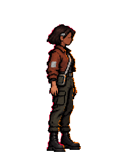
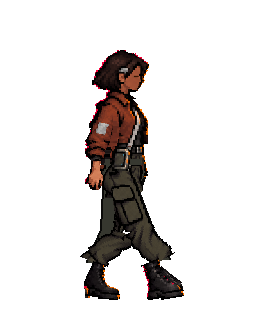

# Sota · prueba aislada de contacto derecho

14 de octubre de 2026. **Contacto anterior descartado; prueba v2 aprobada visualmente como pose aislada.** Esta revisión mide una sola pose de contacto (`fase 0`) y deja la guía para corregirla. El autor confirma la dirección de conservar la parte superior de v7 y redibujar manualmente pelvis y piernas. Tras detectar y corregir un bolsillo duplicado, valora v2 con «Muy bien, ahora sí». Esta aprobación corresponde a la imagen de contacto, no a un ciclo de marcha ni a su integración. Se conserva un único intento generado como referencia visual, sin cambiar atlas, scripts activos, escenas ni exportaciones. La marcha v4 conserva su aprobación cinemática.

**Intento posterior, tras el visto bueno al enfoque:** se editó la referencia con imagegen para obtener una sola pose de contacto. [PNG del intento, descartado como sprite](contacto_ia_intento1_descartado.png) y [prompt exacto en inglés](prompt_contacto_ia_intento1.txt). La imagen muestra dos piernas separadas, pero mide **1122 × 1402** en vez de 256 × 320; su alfa tiene 252.294 píxeles parciales y solo 597 totalmente opacos. La caja visible es x=25..1101, y=112..1375. Su anchura relativa a la altura (~0,85) excede la del contacto anterior (~0,42), y no conserva literalmente los píxeles de la parte superior. **Sirve, como mucho, para discutir el gesto; no para importar, reducir o calcar como sprite.** No se modificó ninguna imagen existente.

El autor valora este intento como «mucho mejor». Esta valoración orienta el gesto de piernas; no aprueba todavía la resolución, la nitidez, la identidad exacta ni el uso en el juego.

## Prueba v2 al tamaño del juego · pendiente de valoración

El autor detectó que **el bolsillo se duplicaba al caminar** en la primera composición: se superponía el bolsillo del pantalón original en reposo al de la pierna adelantada. Se conserva [v1](contacto_derecha_prueba_v1.png) como evidencia del fallo. [Comparación v2 a 1×](comparacion_reposo_contacto_v2.png) · [v2 aislada, 256 × 320](contacto_derecha_prueba_v2.png) · [v2 a 4× con `nearest`](contacto_derecha_prueba_v2_4x.png). La nueva máscara deja de copiar el bolsillo antiguo: conserva los píxeles v7 hasta la fila 175 y, debajo, solo la mano original por delante. La pierna cercana adelantada conserva el único bolsillo visible; la lejana queda sin bolsillo. Aún no existe una secuencia de marcha que pruebe la persistencia de esta identidad entre fotogramas.

### Historial de la composición v1

[Comparación 1×: reposo v7 y contacto propuesto](comparacion_reposo_contacto_v1.png) · [contacto aislado, 256 × 320](contacto_derecha_prueba_v1.png) · [ampliación 4× con `nearest`](contacto_derecha_prueba_v1_4x.png).

La herramienta aislada [`proyectar_contacto.gd`](proyectar_contacto.gd) toma el gesto de la referencia generada, lo muestrea una vez con `nearest` sobre la cuadrícula final y reajusta la anchura bajo la cintura. Sustituye la parte superior por los píxeles exactos de `v7_reposo_derecha.png` hasta la fila 185 y conserva mano y equipo visibles unas filas más. Los píxeles inferiores se asignan a colores presentes en el reposo v7 a tamaño de juego. Esto **no equivale a un redibujo manual completo** de la tela: la unión de cintura, pliegues y silueta deben valorarse artísticamente antes de aceptar esta pose.

Comprobación: 256 × 320; alfa solo 0/255; 12.352 píxeles opacos; caja visible inclusiva `(80,48)..(183,299)`; cero RGB fuera de la paleta del reposo v7; cero diferencias en las filas 0..185 respecto del reposo original. Las dos botas ocupan zonas separadas junto al suelo y las punteras visibles incluyen `(121,294)` y `(183,295)`, próximas a las punteras v4 `(119,86;294,95)` y `(183,86;294,47)`. El script verifica marco, alfa, parte superior y dos apoyos con aserciones. La comparación se presenta sin reescalado; la ampliación usa solo `nearest`.

**Estado de v2:** aprobada visualmente por el autor como única pose de contacto. Tiene 12.359 píxeles opacos, alfa solo 0/255, cero RGB ajenos al reposo v7 y cero diferencias con el reposo en las filas 0..175. La caja visible y las punteras de prueba siguen en los mismos lugares. No se ha añadido a ningún atlas ni se ha ejecutado como personaje activo. La continuidad de pelvis, piernas y bolsillo entre fases sigue sin comprobar.

## Comparación a escala real del juego

| Reposo v7, extraído del PNG original con `nearest` y corte de alfa | Contacto de prueba anterior, descartado |
| --- | --- |
|  |  |

Abrir ambos PNG al 100 % para juzgar la lectura en juego. Si se amplían, usar solamente múltiplos enteros con `nearest`. El contacto anterior procede de una base generada y de polígonos de tela: conserva bastante bien la cabeza y el equipo, pero pierde la continuidad de pelvis, muslos, puños y botas. No reutilizarlo como dibujo final.

## Medidas verificadas

| Elemento | Dato |
| --- | --- |
| Fuente inalterada | `godot/assets/personajes/sota/perfiles_pixel_v7.png`, 1536 × 1024 RGBA; SHA-256 `c1fe26186ad169ed4473025721e0fe06daf276f5544ecac5d9d251534cfafa6a` |
| Perfiles | Dos regiones de 768 × 1024. Alfa ≥ 0,95: derecha x=363..599, y=76..944 (869 px); izquierda x=947..1162, y=80..944 (865 px). El alfa ≥ 0,10 incluye halo y ocupa 871/868 px de altura. |
| Transparencia fuente | 1.278.872 píxeles con alfa 0; 293.992 con alfa parcial; **ninguno con alfa 255**. El brillo exterior y el antialias están dentro del PNG. |
| Tamaño de píxel | No existe paso lógico único: en la ropa hay degradados y miles de RGB distintos, además de bloques de distinto tamaño. Es pixel art estilizado a 1536 × 1024, no un sprite ya dibujado sobre la cuadrícula final. `nearest` conserva el muestreo, pero no elimina la suavidad que ya está pintada dentro de la fuente. |
| Escala Godot | Derecha `252/869 = 0,2900`; izquierda `252/865 = 0,2913`. Marco de trabajo 256 × 320; silueta derecha de reposo x=90..158, y=48..299 tras el corte. Filtro `nearest`, sin mipmaps. |
| Anclajes | El JSON original registra pivotes **provisionales** `(482,946)` derecho y `(287,947)` local izquierdo. El modelo Godot usa como bases de textura `(493,5;945)` y `(1027;945)`; el marco final usa raíz `(128,300)` y suelo global `y=705`. No confundir la base de textura con la articulación anatómica de la cadera. |
| Contacto v4 | Fase 0 de 32, ciclo 128 px, velocidad 104 px/s. En la celda 256 × 320: puntera lejana `(119,86;294,95)`, puntera cercana `(183,86;294,47)`, oscilación corporal `+2 px`. Estos valores están en `articulada_v1/movimiento.json` y coinciden con el atlas provisional v5. |
| Contacto anterior | 256 × 320, píxeles visibles x=80..183, y=50..299, alfa solo 0/255; **735 píxeles visibles** tienen RGB que no aparece en la zona opaca de v7. Pasar medidas de alfa y marco no equivale a pasar revisión artística. |

La ruta activa `godot/movimiento_sota.gd` lee `articulada_v5`, no esta prueba. El fallo anterior viene de intentar animar superficies ocultas en un dibujo plano: el rig recorta polígonos y reutiliza UV de v7; el Modelo 9 añadió piernas nuevas pero las proyectó sobre polígonos estrechos y siguió sin una pelvis continua. La prueba de cuatro claves posterior añadió tela de una imagen generada, con cambios de paleta y contornos. Las comprobaciones de cobertura solo certificaron regiones internas, no una silueta anatómicamente correcta.

## Instrucción de redibujo para **una** pose

1. Crear una copia editable de `v7_reposo_derecha.png` en **256 × 320**, RGBA; mantener intactos cabeza, pelo/mecha gris, cara apenas definida, chaqueta, manga, correa, bolsa, mano y equipo. Conservar el mismo origen `(128,300)`. La identidad de v7 es la referencia, no el contacto descartado.
2. Redibujar manualmente desde la cintura hasta las botas en la **cuadrícula final de 256 × 320**, con pelvis continua y dos piernas de volumen comparable. La pierna cercana lleva siempre el bolsillo; la lejana queda detrás y no toma fragmentos de la primera. No rotar recortes de tela para rellenar superficies que v7 nunca mostró.
3. Usar las punteras de fase 0 indicadas arriba como blancos cinemáticos. La unión cadera→muslo→rodilla→caña→bota debe poder seguirse en cada pierna; conservar suelas y orientación de las botas de Sota. Ajustar los contornos y pliegues píxel a píxel en esta pose, no mediante deformación continua ni una generación de imagen.
4. Elegir colores de los píxeles visibles de la referencia v7 **ya rasterizada al tamaño de juego**; preservar sombras y contornos del equipo. Exportar RGBA con alfa 0/255, sin interpolación, suavizado, nuevo halo ni recentrado. Mostrar primero a 100 % y luego a 400 % con `nearest`.
5. Valorar visualmente junto al reposo: identidad y altura, pelvis completa, grosor de muslos y pantorrillas, cruce legible, puños conectados, dos botas propias, bolsillo estable y bordes nítidos. Registrar también tamaño, alfa, anclaje y diferencias de color. **Solo la valoración del autor** decide si esta única pose sirve para continuar.

La fuente v7 no contiene la tela tapada de ambas piernas ni todas las caras de las botas. El redibujo de esas zonas exige criterio artístico manual. No hay aquí una pose nueva terminada que pueda garantizar identidad, anatomía y nitidez a la vez.
