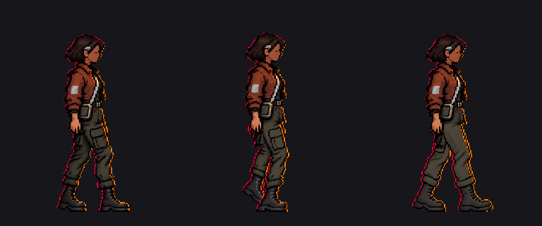

# Sota · impulso derecho, tercera clave aislada

15 de octubre de 2026. El autor dio el visto bueno para continuar tras ver el apoyo derecho. Se entrega **una sola prueba nueva**, fase `16/32 = 0,50`, para valoración visual. No se ha integrado en el juego ni se han generado intermedios, ciclo completo o perfil izquierdo.

[PNG aislado de 256 × 320](impulso_derecho_prueba_v1.png) · [ampliación 4× con `nearest`](impulso_derecho_prueba_v1_4x.png).

## Construcción y comprobaciones

- Cuatro referencias generadas se conservan como `referencia_ia_intento1..4.png`, con sus [prompts exactos en inglés](prompts.txt). La primera tenía una zancada excesiva; la segunda la acortó; la tercera recuperó los colores y contraluces; la cuarta quitó manos generadas que se duplicaban con la mano aprobada. Ninguna es un sprite importable.
- [`preparar_impulso.gd`](preparar_impulso.gd) muestrea la cuarta referencia mediante `nearest` en la cuadrícula 256 × 320. Sustituye las filas 0..175 por los píxeles exactos del contacto v2 y coloca su mano aprobada delante del pantalón. Los demás píxeles visibles se asignan a colores presentes en el contacto v2. No se copia el bolsillo de la pierna adelantada del contacto: la pierna cercana retrasada lleva **un solo bolsillo** y la lejana adelantada es lisa.
- Marco y pivote: 256 × 320, raíz `(128,300)`, caja visible `(72,48)..(186,299)`, alfa solo 0/255. La parte superior coincide píxel a píxel con el contacto v2. Las punteras medidas en la banda inferior llegan a x≈119 y x≈186, frente a los blancos v4 x≈120 y x≈184; el pie delantero queda 2 px más adelantado. El script incluye aserciones de marco, alfa, parte superior y punteras.
- La comparación a 1× permite ver el gesto y el bolsillo. La ampliación deja revisar bordes, entrepierna, unión de puños y botas. **No se ha probado deslizamiento ni continuidad**, pues faltan las fases contiguas. La pose procede de una referencia generada y muestreo con paleta, no de redibujo manual completo.

**Valoración posterior:** el autor autoriza continuar con «adelante» tras conocer que esta tercera pose requería valoración y que el siguiente paso era la fase 24. Se preparó un [diagnóstico aislado de esa fase](../avance_derecho_v1/README.md), todavía sin aprobación del ciclo. Quedan por valorar pelvis, volumen de ambas piernas, bolsillo, contraluz, botas y transición visual. La parte superior conserva el mismo brazo y mano del contacto, por lo que el balanceo del brazo aún requiere una solución común antes de animar.
