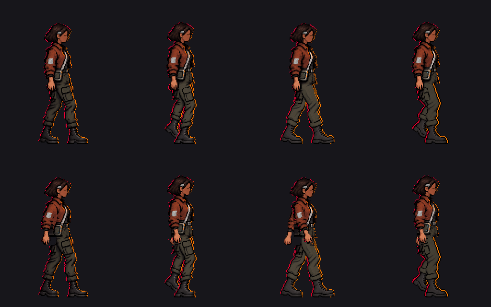

# Sota · prueba aislada de brazos y manos en las cuatro claves

15 de octubre de 2026. El autor aclara que su queja anterior era que **se habían olvidado las manos**; confirma que el nuevo balanceo de brazos es el movimiento buscado y, tras ver el detalle ampliado, dice que las manos le parecen correctas. Esta carpeta guarda la corrección de diagnóstico separada; los PNG originales de contacto, apoyo, impulso y avance no se modifican ni se integran en el juego.

[Cuatro claves con manos en movimiento a 1×](comparacion_manos_prueba_v1.png) · [ampliaciones individuales 4×](clave_0_manos_prueba_v1_4x.png): `clave_0`, `clave_1`, `clave_2` y `clave_3`.

[Detalle de las cuatro manos a 4×: referencia v5 arriba y composición con las piernas nuevas abajo](comparacion_detalle_manos_4x.png). Se amplía con `nearest`, sin suavizado.

**Corrección del hueco bajo la mano de la cuarta clave:** el autor detectó un recorte visible sobre fondo claro. [Antes y después a 8× sobre gris](hueco_antes_despues_8x.png) · [cuatro claves a 1× con la cuarta corregida](comparacion_manos_prueba_v2.png) · [cuarta clave v2](clave_3_manos_prueba_v2.png). [`reparar_hueco_mano_v2.gd`](reparar_hueco_mano_v2.gd) repone 21 píxeles de tela y contorno en `(101..112,188..192)` que la máscara había vaciado. Los colores se toman de los píxeles vecinos de la propia prueba. La v1 queda conservada.

## Método y comprobaciones

- [`comparar_referencias.gd`](comparar_referencias.gd) coloca [v4 frente a las cuatro claves](v4_frente_a_claves_actuales.png) y [el atlas v5 frente a las mismas](v5_frente_a_claves_actuales.png). La cinemática v4 aprobada mueve los brazos en oposición a las piernas. El atlas v5 conserva ese movimiento y contiene tela reconstruida bajo los brazos; su acabado de piernas fue rechazado y no se reutiliza aquí.
- [`probar_manos.gd`](probar_manos.gd) hace cuatro **copias nuevas** de las claves. Toma las filas 0..173 del atlas v5 para cada fase 0/8/16/24, elimina la mano inmóvil de la clave anterior y añade las manos visibles de v5 con una máscara local. Elimina la prueba inicial que copiaba hasta la fila 205 y arrastraba pantalón/basura del atlas. No cambia ningún píxel de las piernas **desde la fila 211 hasta el suelo**.
- El script comprueba 256 × 320, alfa solo 0/255, igualdad exacta con las piernas anteriores en filas 211..319 y más de 100 píxeles distintos en la zona de brazos respecto a la primera clave. También comprueba que **todos los píxeles de piel de las manos de v5 entre las filas 174 y 210 se conservan exactamente** y que ninguno de esos píxeles queda por debajo del límite de composición. La comparación 1× muestra el brazo cercano atrás en contacto, más centrado en apoyo, delante en impulso y de vuelta hacia el centro en avance. En impulso se distingue también la mano lejana detrás.

**Límite artístico:** los dedos visibles coinciden con v5 en la zona comprobada, pero esta sigue siendo una composición técnica y no un redibujo terminado. En especial, la tercera mano queda delante de una unión de pantalón aún incompleta y la máscara puede dejar tela oscura alrededor de los puños. La aprobación del autor cubre el **gesto y las manos mostradas**, no certifica esos encuentros ni las piernas. Las cuatro claves originales siguen disponibles. También sigue pendiente corregir los apoyos de la cuarta clave y revisar el bolsillo al animar.

La v2 corrige solo el hueco señalado. El script comprueba que el cambio se limita a esos 21 píxeles, mantiene alfa binaria y conserva exactamente las filas 211..319 de la cuarta pierna. **El autor confirma visualmente que el hueco corregido le parece bien**; esta valoración no resuelve los apoyos de la cuarta postura.

**Siguiente revisión manual:** conservar hombro→codo→muñeca y los dedos aprobados; al redibujar las piernas, resolver píxel a píxel la tela visible detrás de cada mano y el encuentro con los puños. Después comprobar que bolsillo y botas mantienen su identidad antes de dibujar intermedios. No hay atlas nuevo ni cambio en el recorrido.
